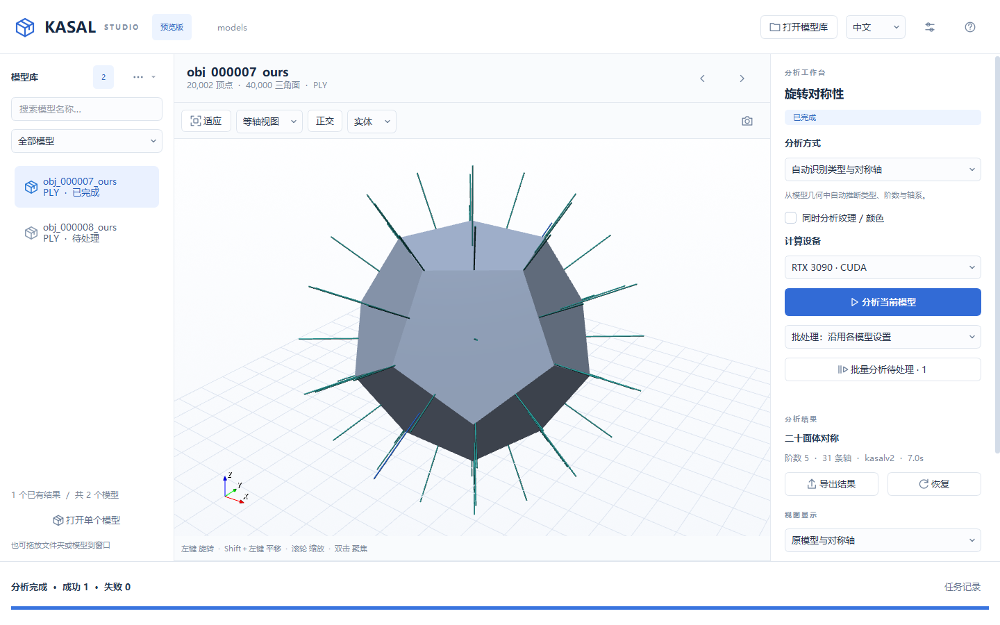
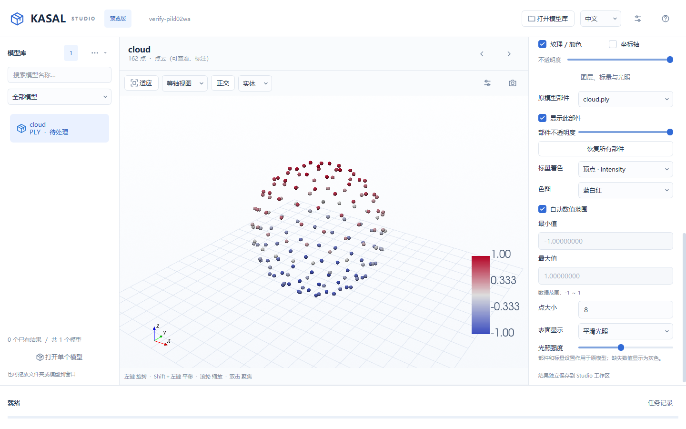

# KASAL Studio：功能拆解与新版桌面设计

Studio 是独立的浅色桌面应用，沿用 KASAL 的算法、任务规格和标注格式。旧 Polyscope 应用与入口保留。

## 启动与预览

在项目根目录使用已配置的 `py3d` 环境：

```powershell
& 'C:\Users\L\miniforge3\envs\py3d\python.exe' .\demo_studio.py
# 也可指定模型或目录：
# python -m kasal.studio "D:\models"
```

首次启动打开自带几何示例；之后记住上次打开的目录，以及各模型库上次选中的模型、设备、预处理和批处理方式。预览版仍是独立入口，不替换 `kasalv2` 命令。



桌面依赖安装命令：`python -m pip install -r requirements/studio.txt`。当前机器已安装 PySide6 6.10.3、VTK 9.7.2，并保留原有计算依赖版本。

## 现有软件的功能

| 功能域 | 旧版能力 | 新版组织方式 |
| --- | --- | --- |
| 数据集 | 选择目录、递归发现 PLY/OBJ、上一个/下一个 | 左侧模型库、搜索、状态筛选、拖放目录或文件 |
| 三维查看 | 几何/纹理、坐标轴、对称结果、透明度、截图、复位 | 中央视口，网格/点云、标量着色、部件控制、实体/线框、透明度、对称轴、标准视角；原模型与结果 PLY 切换 |
| 对称参数 | 九个选项（无对称与八类对称）、阶数 2–90、ADI-C、X/Y/Z 约束 | 右侧“自动识别 / 已知类型”工作流；自动模式不要求预填标签 |
| 计算 | v1/v2、当前计算、只计算未保存项的增量批处理 | 异步子进程、进度、成功/失败统计、取消；批处理可独立指定引擎或沿用各模型参数 |
| 标注管理 | 保存、恢复、全部标为未保存、清除标注 | 独立 Studio 结果、草稿自动保存、人工标注直接保存/导出、读取旧标注、恢复；清除只影响 Studio |
| 设置 | 中英文、字号、预处理策略、CPU/CUDA、硬件信息 | 顶栏即时切换语言，设置内可预览/取消；Qt 按钮和文件对话框随语言切换；设置内显示硬件信息 |

主要复用接口：`SymmetryJobSpec`、`run_symmetry_job`、`parse_symmetry_type_dict`、`build_symmetry_type_dict`、`save_ply_model`。界面使用自身状态，不复用旧 GUI 的全局状态机。

## 交互调研与选择

三维工具的按键并不完全一致。Blender 默认中键旋转、Shift＋中键平移；VTK 默认左键旋转、中键平移、右键缩放，也支持 Shift＋左键平移。此处选择更适合模型查看和标注的 VTK 操作方式，不改变模型坐标。

| 操作 | Studio 约定 |
| --- | --- |
| 左键按住拖动 | 围绕观察中心旋转 |
| 中键或 Shift＋左键拖动 | 平移 |
| 滚轮 / 右键上下拖动 | 缩放 |
| 双击模型 | 将点击表面设为观察中心 |
| F / 工具条“适应” | 模型完整入镜 |
| 1 / 3 / 7 | 正面 / 右侧 / 顶部 |
| 5 | 正交与透视切换 |
| Ctrl＋O / Ctrl＋Shift＋O | 打开目录 / 打开文件 |
| Ctrl＋Enter | 分析当前模型 |
| Ctrl＋S | 保存人工标注（人工模式，无需计算） |
| PageUp / PageDown | 上一个 / 下一个模型 |

视图快捷键仅在视口获得焦点时生效，避免在输入框输入数字时转动视角。

参考资料（2026-11-06 查阅）：

- [VTK TrackballCamera](https://vtk.org/doc/nightly/html/classvtkInteractorStyleTrackballCamera.html)：旋转、平移、缩放按键。
- [Polyscope 相机控制](https://polyscope.run/py/basics/camera_controls/)：双击聚焦、正交/透视、视角恢复。
- [Blender 导航](https://docs.blender.org/manual/en/3.0/editors/3dview/navigate/navigation.html)：轨道旋转、平移、视图快捷键。
- [Blender 导航控件](https://docs.blender.org/manual/en/latest/editors/3dview/navigate/introduction.html)：轴向视角与投影切换。
- [Qt for Python](https://doc.qt.io/qtforpython-6/quickstart.html)、[VTK Qt 集成](https://docs.vtk.org/en/latest/api/python/vtkmodules/vtkmodules.qt.QVTKRenderWindowInteractor.html)：桌面实现依据。

## 并行保留与数据边界

- 旧版仍使用 `demo_shape_meshes.py` / `demo_texture_meshes.py`，不修改其入口。
- 新版使用 `demo_studio.py` / `python -m kasal.studio`。
- 新版结果写到数据集的 `.kasal-studio/` 下，保留相对子目录；旧模型旁的标注仅作为可读取的输入。
- 计算进程调用算法时关闭原位置导出，成功结果才提交到 Studio 目录；取消不覆盖此前结果。
- 同名不同扩展的输入通过扩展名子目录区分，避免结果碰撞。
- 危险操作需要明确确认，并限定于 Studio 自己的结果。
- 每次完成分析创建一个完整的结果版本，再原子更新 `current.json`。清除操作将 Studio 结果移入 `.kasal-studio/.trash`，不删除旧版文件。
- 参数变化自动保存到各模型 Studio 目录的 `draft.json`，下次打开继续编辑；草稿与计算结果分开，视图仍展示上一次计算结果。新计算结果使旧草稿失效。“恢复”会舍弃草稿并重读已保存结果。
- 完成人工标注也创建一个独立结果版本，使用兼容旧版的 JSON 和额外的 `studio.kind=manual_annotation` 标记。清空旧计算轴系及纹理结论，不附带旧 PLY；之前的计算版本仍在历史目录中。导出不会覆盖目的目录中的同名文件。
- 界面偏好使用独立的 Qt 设置，不改写旧版 `KASAL.json`。

## 实现结构

`kasal/studio/model.py` 管理模型与结果；`worker.py` 隔离计算与导出；`viewport.py` 负责 VTK 视图；`geometry.py` 读取标量属性；`display.py` 管理显示设置；`window.py` 组织 Qt 界面；`i18n.py` 管理即时翻译及 Qt 标准控件语言；`theme.py` 管理视觉样式。

桌面依赖单列在 `requirements/studio.txt`，不加入旧版默认依赖。

## 验证与当前边界

- **完整维护测试（8 项）**：在 `py3d` 环境运行 `python -m pytest tests --desktop -q`。桌面依赖缺失时直接报错，不静默跳过。
- **无窗口测试 / CI（6 项）**：`python -m pytest tests -q`，仅需 `requirements/base.txt` 和 `requirements/test.txt`。`tests/test_cli.py` 保留真实 v1 计算/导出/增量运行和数据集成功/失败汇总；`tests/test_io_step.py` 保留独立的 STEP 到轴系流程；`tests/test_storage.py` 保留 JSON 中断写入、Studio 提交中断、导出失败三项数据保护检查。数据集测试只替换昂贵的 v2 搜索，读写和导出使用真实实现。
- **桌面流程（2 项）**：`python -m pytest tests/desktop --desktop -q`，需要可用的图形桌面、Studio 依赖与完整算法环境。`tests/desktop/test_studio.py` 使用临时副本和隐藏窗口，覆盖真实 v2/纹理计算、增量批处理、取消、导出/清除，以及点云/标量查看、拖动视角、语言切换、草稿重开和人工标注。
- 维护时优先更新上述工作流；已由工作流验证的行为不再单独写局部测试。阶段性复现、参数异常排列、旧界面模拟和专项渲染检查已移除，不把每次修复都扩展成永久测试矩阵。此集合用于保护核心路径，不追求所有边界和界面细节覆盖。
- 临时文件交给 pytest 管理；需要报告时可加 `--junitxml=.local/studio/test-results.xml`。`scripts/verify_pytorch3d.py` 继续用于安装诊断与独立的 CPU 算子 CI，不新增专项验证脚本。
- 模型载入仍在主界面线程完成，超大模型可能短暂等待；对称分析在独立进程执行。
- 界面语言支持中文和英文，即时生效，无需重启；文件名、算法标识、原始异常和历史任务日志保持原文。
- 首版保留常用查看与标注功能，没有复刻 Polyscope 的底层调试面板及所有渲染参数。
- 结果代际历史暂不自动清理；需要回收空间时可使用界面清除功能，再按需要处理工作区回收目录。
- 补充算法观察：`trimesh.creation.icosphere(subdivisions=3)` 生成的球面在当前 v2 默认配置下被识别为圆柱对称。Studio 保留算法输出，不自行把结果改成预期标签；此次重写不调整算法阈值或识别精度。界面流程验证通过不代表所有模型分类正确。

## 与旧界面的逐项核对（2026-11-07）

依据为本地 `51a1ec0` 的 `kasal/app/polyscope_app.py`、`kasal/annotations/io.py`、`kasal/device.py` 和 `kasal/compute/symmetry_job.py`，对比的是实际操作和文件行为，不只比较按钮数量。旧应用和计算核心未修改。

| 旧版功能 / 位置 | Studio 状态 | 核对结论 |
| --- | --- | --- |
| 递归模型库、上/下一个模型 | 已覆盖 | 增加搜索、状态过滤、单文件打开和拖放；支持六种网格格式 |
| 语言、字体大小 / `preprocess_setup_callback` | 已修复 | 原先仅保存语言、需重启；现在即时更新文字，保留相机、选择、搜索、参数和运行状态 |
| 设置保存及起始模型 / `_load_kasal_json_gui_settings` | 已补齐常用行为 | 按模型库记忆位置、设备、预处理和批处理方式；不自动导入旧 `KASAL.json`，使用独立设置 |
| 自动分类、已知类型定位、九类类型、阶数和 XYZ 约束 | 已覆盖 | 通过两个明确工作流组织；自动模式主动忽略人工类型/轴约束，已知类型模式使用 v1。与旧版自动路由逻辑不同 |
| ADI-C、UV 纹理、顶点/面颜色 | 已覆盖 | 支持纹理显示及分析；已用真实纹理 OBJ 验证 |
| 单模型与批处理独立引擎 / `_main_toolkit_callback` | 已补齐 | 批处理增加“各模型设置 / 全部自动 v2 / 全部已知类型 v1”；仍只处理待处理项 |
| 批处理跳过无效参数、继续下一项 / `_cal_all_batch_start_next` | 已修复 | 参数无效记为失败并继续；此前预检查一个失败会阻止整批启动。结果已损坏的模型仍需单独重试 |
| 后台计算、进度、取消、失败保护 | 已覆盖 | v1/v2 子进程、失败统计、取消后保留以前的结果；测试通过 |
| 生成的 `*_sym.ply` 显示 / `_display_object_mesh` | 已补齐 | 显示中可切换原模型与“对称分区与轴”：结果表面使用柔和配色，独立绘制清晰轴线；兼容旧版 PLY |
| 坐标轴、透明度、复位、截图 | 已覆盖 | 增加网格、标准方向、实体/边线/线框、快捷键 |
| 切换模型时保存参数 / `_navigate_object` | 已补齐草稿保存 | 参数变化后立即独立保存，重开仍可继续；不把未计算草稿冒充计算结果 |
| 不计算、直接保存并导出人工标注 | 已补齐 | 选择人工模式后可“保存人工标注（不计算）”，包括无对称标签；保存后可导出 JSON。明确显示为人工标注，移除旧轴系和旧 PLY 显示 |
| 恢复、全部标为待处理、清除标签 | 已覆盖且范围不同 | 恢复会舍弃草稿；清除只移动 Studio 结果到工作区回收目录，不删除模型旁的旧标签 |
| CPU/CUDA 选择、物理硬件信息 / `_render_torch_device_panel` | 已补齐 | 设置中显示 CPU/GPU 与可用状态；CUDA 不可用的 NVIDIA 硬件也会列出 |
| 点云、顶点/面标量场 / `_register_mesh_visualization` | 已补齐常用查看能力 | PLY 点云、点颜色/大小，PLY 顶点/面的数值属性、色图、图例、自动/自定义范围；点云可人工标注，计算仍要求网格 |
| Polyscope 内置结构/材质/调试面板 | 已补齐常用显示控制 | 文件内逐对象/材质部件的显隐和透明度、平滑/平面/无光照、光照强度；底层调试、任意材质编辑及全部渲染参数暂不复制 |
| 任务诊断 | 常用状态已覆盖 | 新版保留本次会话任务记录；原始算法异常保留原文。旧版 `_kasal_log` 输出终端，两者均不是持久日志数据库 |

“对称分区与轴”根据已保存的离散变换重建表面分区，使用稳定的蓝绿紫配色。着色时补齐单位变换，在以旋转中心为原点、按模型尺寸归一化的坐标中确定性地选择参考点，按 `argmin_i ||T_i(x) - r||` 分配顶点。颜色表示对应变换的代表分区，不表示置信度、单根轴的阶数，也不意味着同色顶点属于同一轨道。调色板检查最终 8 位 RGB 不重复；高阶分区仍可能颜色相近。

该规则由 v1、v2 和 Studio 共用；BOP 变换列表不增添单位变换。旧结果无需重新分析即可修正视图分区，旧 PLY 文件不自动改写；如需导出修正后的着色，应重新分析一次。能够从标注恢复轴系时，仅在显示副本中移除与项目箭头模板拓扑完全匹配的末尾箭头，换成带浅色描边的加粗琥珀色平头轴线，不附加端点标记；“对称轴”开关可统一控制。未知几何保持原样。自动适应包含可见轴端，参考网格降低不透明度，避免干扰轴线。

推送前将维护集合收缩为 6 项无窗口测试和 2 条桌面流程；测试和辅助代码共约 470 行。临时模型副本用于验证计算与标注主流程，并确认清除 Studio 结果不会改变源模型和旧标注。具体执行结果以 pytest 输出为准。

## 补齐功能的取舍与使用

人工标注保存/导出是标注工具的必要能力，用于人工判断、纠正分类和明确记录“无旋转对称”。点云与标量显示用于检查扫描数据、质量值和置信度；部件控制有助于观察遮挡区域。此次补齐这些直接影响工作流的能力。Polyscope 的底层调试、完整材质编辑和所有渲染参数不属于当前核心标注流程，暂不复制。

- **人工标注**：右侧选择“人工标注 / 已知类型”，设置类型/阶数/约束，点击“保存人工标注（不计算）”或按 Ctrl＋S，再点击“导出结果”。修改草稿后需要再次保存才能导出新版本；单模型“分析”仍可重新计算，批处理默认跳过已完成的人工标注。
- **点云**：直接打开 PLY 点云，会默认进入人工模式。支持旋转、平移、缩放、点颜色、点大小及截图；点云计算按钮禁用，批处理排除已识别的点云。底层预处理要求三角面，本次不增加点云重建或改变算法输入。
- **显示设置**：点击视口右上角的滑杆图标，会展开并定位右侧“图层、标量与光照”。可选择部件并调整显隐/不透明度，或一键恢复所有部件。分组以源文件中的对象/材质节点为准，不自动拆分单一网格的连通分量。
- **标量着色**：选择 PLY 顶点或面的数值属性，提供紫绿黄、蓝白红和灰度三种色图及图例。自动范围忽略 NaN/Inf；缺失值为灰色；恒定值使用有限的显示范围。关闭标量着色后恢复原模型颜色/纹理。标量选项不改变计算输入。
- **光照**：平滑/平面适合查看几何，无光照适合核对原始颜色；强度仅改变显示，不改变模型和标注。



显示设置在当前模型内保持，语言切换不重置；重新载入模型时部件显隐、透明度及标量选择重置。部件与标量设置作用于原模型；结果视图为离散对称分区换用协调配色，连续对称结果保留原来的表面颜色。未保留对应关系的属性（如多边形三角化或 UV 分裂造成长度变化）会跳过，避免把数值错误贴到其他顶点/面；当前重点支持点云及三角网格 PLY 的数值字段，不承诺任意格式的自定义属性。

实现参考：[VTK 标量映射接口](https://vtk.org/doc/nightly/html/classvtkMapper.html)、[Trimesh PLY 读取源码](https://github.com/mikedh/trimesh/blob/main/trimesh/exchange/ply.py)、[Trimesh 点云接口](https://trimesh.org/trimesh.points.html)。实现使用现有 py3d 依赖，无新增安装项。

## 自查修复记录（2026-11-07）

| 复现条件 | 修复后的行为 |
| --- | --- |
| 搜索无匹配项，或最后一个待处理模型被保存 | 清空选择、模型、坐标轴和结果显示，禁用当前模型操作；不会继续操作列表之外的旧模型 |
| 后台计算时搜索另一个模型 | 列表高亮与视口同步切换；计算进程继续持有原任务，不会把结果写给当前浏览的模型 |
| 在“待处理”筛选下保存人工标注 | 正确保存并记录原模型；该行移出列表后不会因当前选择变化而报错或记错文件名 |
| 修改曾因参数不合法而失败的任务 | 清除过时的参数/计算错误，允许再次进入批处理；读取错误仍保留诊断 |
| 使用方向快捷键、鼠标导航或切换模型 | 视角下拉框跟随预设方向更新；手动操作显示“自由视角”，载入新模型显示等轴视图 |
| 旧 JSON 中含连续轴偏移或离散旋转平移 | 从偏移/变换恢复轴的位置，不再一律把轴画在模型包围盒中心 |
| 90 阶等高阶结果中相邻轴很接近 | 仅合并重复方向及其反向，保留不同的相邻轴；90 条独立轴的回归用例通过 |
| 坐标包含非有限数值、纹理结果字段类型错误 | 在进入 VTK 前检查，显示错误并保持主窗口可用；语言切换不会清掉未解决的显示错误 |
| 外部程序在原路径更新旧版结果 PLY | 按修改时间和文件大小使缓存失效，恢复结果时显示新文件 |
| `current.json` 损坏，或结果版本缺少标注 JSON | 明确报告错误，不会静默当作未标注模型 |
| 待提交结果元数据无效，或应有的结果 PLY 缺失 | 提交前拒绝该结果，保留以前的版本指针；无旋转对称结果和人工标注允许没有 PLY |
| 导出中发生读写失败 | 清理本次创建的不完整文件，保留目的目录原有文件；使用独占创建避免覆盖同名文件 |

测试覆盖包含故障注入、临时中文路径、真实后台进程和隐藏的 Qt/VTK 窗口，现已统一到上述 pytest 入口。此轮修复没有修改旧版应用入口、计算核心或项目依赖；超大模型同步载入和既有算法分类边界仍按上文说明保留。
